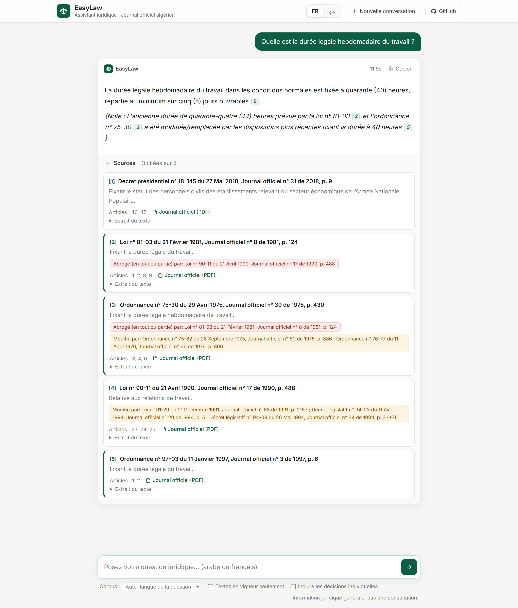
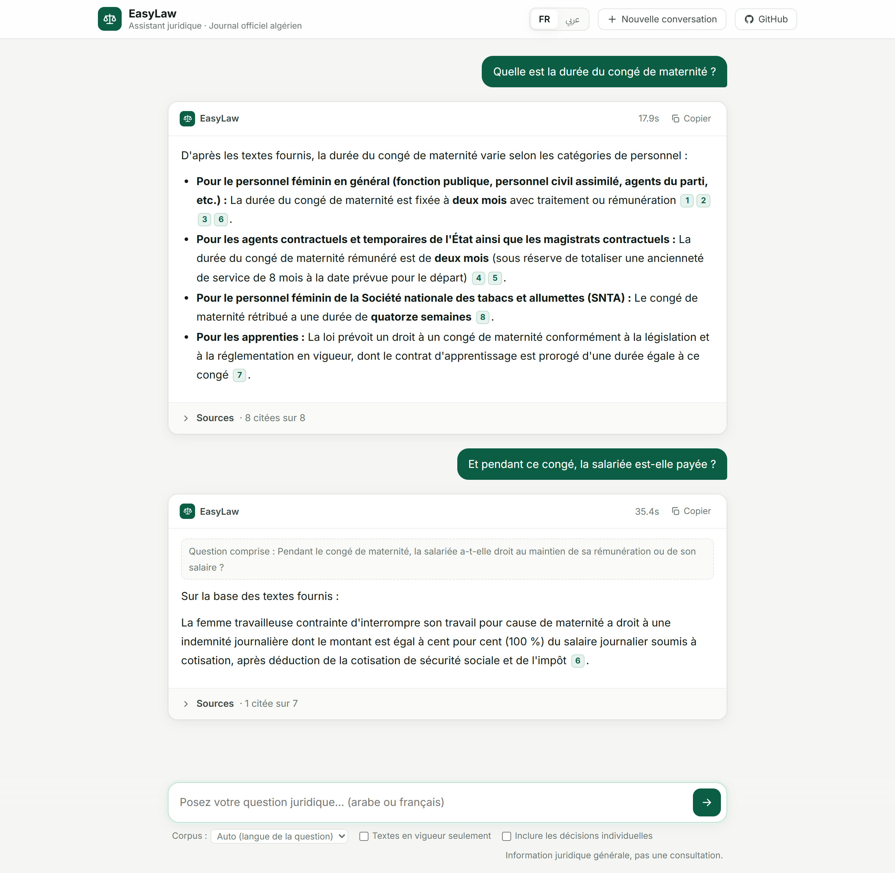
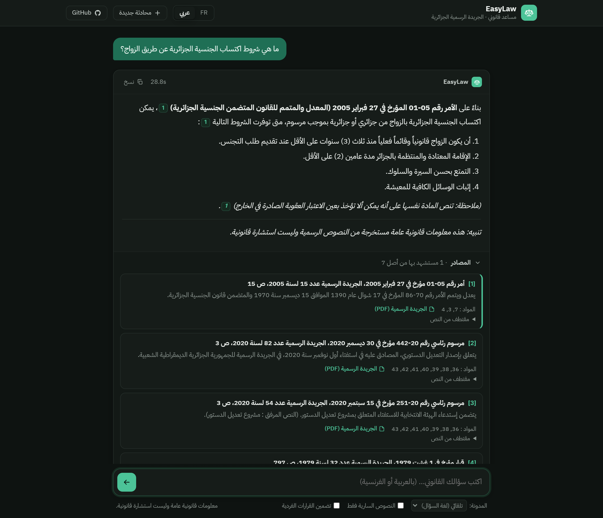

# EasyLaw RAG — Algerian law assistant (Arabic · French)

Ask a legal question in **Arabic or French** and get an answer grounded in the Algerian *Journal officiel*
(JORADP): every statement is tied to a numbered source, every source links to the official PDF, and texts that
were later **amended or repealed are flagged**.

> Hybrid retrieval (BGE-M3 dense + sparse, RRF) over **~850,000 passages** from 1962 to today, cross-encoder
> reranking, grounded generation with Gemini, a bilingual chat UI and a measured evaluation.



<table>
<tr>
<td width="50%"><br><sub>Follow-up questions are rewritten into standalone legal questions before searching.</sub></td>
<td width="50%"><br><sub>The same system in Arabic (right-to-left), dark theme.</sub></td>
</tr>
</table>

## Results

Measured on a fixed set of 50 questions, each asked in Arabic and in French
([`eval/questions.jsonl`](eval/questions.jsonl)). A question counts as found when the law a lawyer would cite
(e.g. *Loi 90-11* for annual leave) is among the retrieved texts.

**Retrieval**

| | hit@1 | hit@3 | hit@5 | hit@10 | MRR |
|---|---|---|---|---|---|
| French — hybrid (dense + sparse, RRF) | 0.54 | 0.82 | 0.88 | 0.98 | 0.69 |
| French — **+ reranker** | **0.62** | **0.86** | **0.94** | 0.98 | **0.76** |
| Arabic — hybrid (dense + sparse, RRF) | 0.46 | 0.70 | 0.82 | 0.84 | 0.60 |
| Arabic — **+ reranker** | **0.52** | **0.82** | **0.84** | **0.90** | **0.68** |

Arabic is lower mainly because most Arabic texts come from OCR of scanned journals (noisy digits and words).

**Answers** (30 questions per language, full pipeline, judged by Gemini and by an independent model of another
family, Nemotron, to avoid a model grading itself)

| | French | Arabic |
|---|---|---|
| Expected law among the sources | 93% | 83% |
| Answer cites the expected law | 89% | 80% |
| Grounded in its sources (independent judge) | 96% | 100% |
| Fully answers the question (independent judge) | 100% | 97% |
| **Median time per answer** | **13.5 s** | **14.6 s** |

Answer time went from ~66 s to ~14 s by putting the fast `gemini-3.5-flash-lite` first instead of using it as a
fallback, with no loss in grounding (previous run kept in
[`eval/results/before_lite_first/`](eval/results/before_lite_first/)). The set is small and judged by models, not
lawyers: read the numbers as indicative. 2 of 60 answers and 5 independent judgments are missing because the free
Gemini / OpenRouter tiers were overloaded or out of daily quota during the run.

## How it works

```
joradp.dz ──► journal PDFs ──► page text ──► one document per legal text ──► article chunks ──► BGE-M3 ──► Qdrant
                                (text layer or OCR)  (title-based segmentation)   (~1,000 chars)   dense+sparse

question ──► follow-up rewrite ──► dense + sparse search ──► RRF ──► rerank 40 ──► top 8 ──► Gemini ──► cited answer
              (Gemini, if needed)       (Qdrant)                     (bge-reranker-v2-m3)      (strict grounding prompt)
```

- **Hybrid retrieval**: BGE-M3 gives a dense vector (meaning) and a sparse vector (exact legal terms, law numbers)
  for every passage; Qdrant fuses both rankings with Reciprocal Rank Fusion, then a cross-encoder reranks the
  top 40.
- **Legal metadata, not OCR, for citations**: text numbers, dates and journal references come from the site's
  metadata, so OCR mistakes never reach a citation. The model is told to trust only that line for numbers.
- **Amendment graph**: 32,814 *amended by / repealed by* links are attached to every passage and shown next to
  each source; the prompt asks the model to present the most recent rule as the one in force.
- **Bilingual by design**: Arabic and French editions share the same text ids, so a law and its amendments line up
  across languages; the question's language picks the collection.
- **Query fixes found in the data**: law numbers written right-to-left by the OCR (`17-84` for `84-17`) are
  searched in both orders.
- **Engineering under constraints**: runs on a laptop with a 4 GB GPU (encoder on CPU, reranker on GPU, fp32 since
  the card has no tensor cores); every long job (download, OCR, embedding, loading) is resumable.

## Corpus

| | Arabic | French |
|---|---|---|
| Source | EasyLaw platform scrape (MySQL dumps) + journals re-read for the years it missed | scraped by this project |
| Texts | 68,332 (metadata) | every text listed by the site's search engine, 1962 → today |
| Body text | OCR (Tesseract) | embedded text for recent journals, OCR for scans |
| Indexed passages | 332,129 | 522,009 |

Data quality, gaps and limits are measured in [docs/data_audit.md](docs/data_audit.md) and
[docs/processing_report.md](docs/processing_report.md). Known limits: OCR noise in old Arabic scans, no Arabic
edition before 1964, and no consolidated (up-to-date) versions of amended texts.

## Credits

This started as **EasyLaw**, a team project of the 2CS (SIL) year at ESI Algiers (École nationale Supérieure
d'Informatique): a legal-search platform for Algerian law built with my classmates — scraping of the official
journal, OCR of the Arabic texts, the database of texts and amendments, Elasticsearch search and a web
platform. Original repository: [amira791/EasyLaw](https://github.com/amira791/EasyLaw).

**This repository is my own follow-up work**: the whole RAG system built on top of that team corpus — corpus
cleaning and segmentation into one document per text, article-level chunking, embeddings and the Qdrant index,
hybrid retrieval and reranking, grounded generation, the evaluation, the chat app, and the extension to French.

## Quick start

```bash
python -m venv .venv
.venv\Scripts\activate                       # Windows  (source .venv/bin/activate elsewhere)
pip install -e ".[dev,app,scrape]"
cp .env.example .env                         # then set GOOGLE_API_KEY (free Gemini API key)
docker compose up -d                         # Qdrant

# Arabic corpus from the EasyLaw MySQL dumps (in the parent folder)
python -m easylaw_rag.ingest.load_dumps --dumps-dir .. --out data/interim
python -m easylaw_rag.process.build
python -m easylaw_rag.index.embed_corpus     # GPU, resumable
python -m easylaw_rag.index.store --recreate

# French corpus (and missing Arabic years) straight from the official site
python -m easylaw_rag.ingest.joradp --lang fr --years 2001-2026
python -m easylaw_rag.ingest.joradp_search --years 1962-2026
python -m easylaw_rag.pipeline --lang fr --years 2001-2026

# Ask
python -m easylaw_rag.rag.ask "Combien de jours de congé annuel payé a un salarié ?"
python -m easylaw_rag.app.server             # chat UI on http://127.0.0.1:8000

# Evaluate
python -m easylaw_rag.eval.retrieval
python -m easylaw_rag.eval.answers generate && python -m easylaw_rag.eval.answers judge && python -m easylaw_rag.eval.answers report

pytest
```

OCR needs Tesseract language files (`ara.traineddata`, `fra.traineddata` from
[tessdata_fast](https://github.com/tesseract-ocr/tessdata_fast)) in `.cache/tessdata_fast/`.

## Layout

```
src/easylaw_rag/
  ingest/     sql_dump, load_dumps, audit        EasyLaw dumps -> Parquet, quality audit
              joradp, joradp_search, pdf_pages   official site -> PDFs, metadata, page text
  text/       arabic, lang, clean                normalization, language profiles, OCR cleanup
  process/    segment, chunk, metadata           cut texts, article chunks, citations & amendment graph
              build, build_journals              corpus builders (dump-based / journal-based)
  index/      embed, embed_corpus, store         BGE-M3 embeddings, Qdrant collections
  retrieval/  retriever                          hybrid search + rerank
  rag/        answer, ask                        grounded generation, CLI
  eval/       retrieval, answers                 hit@k / MRR, LLM-judged answers
  app/        server, static/index.html          chat UI (FastAPI + one page)
  pipeline.py                                    one command per (language, years) batch
scripts/      download and pipeline launchers
tests/
```

*General legal information, not legal advice.*
